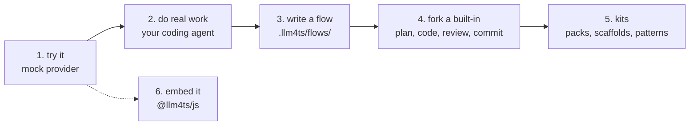

# llm4ts

Effect-native, agent-agnostic engineering workflows with explicit review and modernization artifacts. Effect-TS: typed connectors for API
providers and CLI coding agents, streaming, structured output, plans
and review loops, repository automation, trace replay, and a Node runner.
`llm4ts` began as the TypeScript implementation of
[`llm4zio`](https://github.com/riccardomerolla/llm4zio) and has since gone
its own way.

The whole library climbs one ladder, and so does this README: each step
below is the first screen of a chapter in the
[getting started guide](docs/guide/README.md).



## Try it in one minute

Node 22 or newer, nothing to install, no credentials: the built-in `hello`
flow talks to the mock provider.

```bash
npx -y @llm4ts/shell run hello "What is llm4ts?"
```

`npx -y @llm4ts/shell doctor` shows which coding agents and providers your
machine has; `npm i -g @llm4ts/shell` makes the command `llm4ts`. More:
[chapter 1](docs/guide/01-install.md).

## Do real work

The `implement` flow plans a task, then implements, reviews, and commits it
one task at a time, and resumes where it stopped. Point it at a throwaway
repository and the coding agent you have installed:

```bash
llm4ts run implement --coder codex "Add a multiply function next to add, with tests"
```

`--coder` is `claude` (default), `codex`, `gemini`, `pi`, `agy`, `grok`,
`cursor`, or `opencode`; the CLI must be installed and logged in.
`llm4ts config set LLM4TS_CODER=codex` makes it the default for every run.
Every task is a commit on the flow's branch, the plan lives under
`.llm4ts/` in that repository, and re-running the same command resumes it.
`llm4ts list` shows the other built-ins: `sdd`, `issue-pr`, `epic-stories`,
the `modernize-*` phases. More: [chapter 2](docs/guide/02-run-a-flow.md).

`llm4ts costs` reads the traces of every past run and reports tokens and
cost per day, per hour, per run, and per model, with a projection for the
run rate you expect — the numbers a budget needs. Measured token counts and
character-count estimates stay in separate columns.

`llm4ts run epic-stories --ui tree …` draws the run as an **agent tree**:
every agent in flight on one line (its story, its executor clone, its task),
the selected story's task checklist, the judge's verdicts, the session log,
and the epic and story boards. `llm4ts watch` draws the same tree from any
trace, live or afterwards, and replays it. More: [chapter 2](docs/guide/02-run-a-flow.md#watching-a-run-the-agent-tree).
With `--otel` the same run shows up in a local Arize Phoenix, or in any
OpenTelemetry backend through the `OTEL_*` variables: [observability](docs/observability.md).
`llm4ts profile --epic <id>` says where a run's time went — model, tools,
gates, merges, waiting — with the biggest sinks first, and nothing of the
code or prompts in it, so it can come back from a customer's server.

`llm4ts tool` is the one command a coder runs inside a task: `list`,
`describe <name>`, and `run <name> --flag value` print a JSON report (ok,
summary, issues) for a job the model would otherwise improvise a script
for — `json-validate` against a JSON Schema or an OpenAPI component,
`diff` of two JSON documents, `xml-validate` against an XSD. A pack names
presets in `## Tools`; every story's brief quotes them, and `llm4ts profile`
counts the ad-hoc scripts that remain. More: [ADR 0048](docs/adr/0048-tool-catalog.md).

`llm4ts mcp` serves the same runs to an MCP client such as Grok Bot,
Claude Code or Cursor: `preflight`, run status, a `run_wait` long poll,
`diagnose`, `costs`, and with `--allow-run` it starts and stops flows. It
speaks stdio by default; `--http` serves `/mcp` on loopback behind a bearer
token. More: [ADR 0041](docs/adr/0041-mcp-operator-server.md) and the
[Grok Bot operator](docs/grok-bot/operator.md).

## Write a flow

A flow is one TypeScript file in `.llm4ts/flows/` of the directory you
launch from. Copy the built-in and it is yours:

```bash
mkdir -p .llm4ts/flows && llm4ts view hello > .llm4ts/flows/hello.ts
```

<!-- prettier-ignore -->
```ts
// Hello: send one prompt to the configured provider and print the answer.
import * as Effect from "effect/Effect"
import {
  apiConnectorFromEnvironment,
  completeAndPublish,
  resolveFlowInput,
  runFlowMain,
  runNode
} from "@llm4ts/runner"

const program = Effect.gen(function* () {
  const input = yield* resolveFlowInput("Say hello and name one thing you can do.")
  const coder = yield* apiConnectorFromEnvironment()
  yield* runNode(
    {
      workDir: input.workDir,
      workspace: input.workspace,
      userPrompt: input.prompt,
      coder,
      environment: process.env
    },
    (context) => completeAndPublish(context.coder, context.events, input.prompt)
  )
})

runFlowMain(program)
```

No `npm install`: the shell resolves `@llm4ts/runner` and `effect` from its
own installation. `runNode` wires HTTP, processes, temp files, persistence,
and connectors, so you never assemble Effect layers; swap
`apiConnectorFromEnvironment()` for `coderFromEnv(process.env)` and the same
prompt goes to your coding agent. More:
[chapter 3](docs/guide/03-your-first-flow.md).

## Fork a built-in

```bash
llm4ts view implement > .llm4ts/flows/my-implement.ts
```

Change the system prompt, add review lenses, a lint gate, a formatter, or
the number of review rounds: they are fields of one options object passed to
`implementPlanFlow`. The
[flow authoring guide](docs/flow-authoring.md) goes deeper, down to custom
task loops. More: [chapter 4](docs/guide/04-fork-a-built-in.md).

## Kits

The `modernize-*` flows rewrite a legacy code base in six phases and know
nothing about any technology. Everything stack-specific comes from a
**kit**: pack manifests with prompts and review lenses, the scaffolds they
seed a target from, translation pattern cards, and stack-only flows. Two
ship built in, `mainframe-java` (COBOL/JCL and ACE to Spring Boot and Kafka
Streams) and `j2ee-nextjs` (JSP to Next.js); yours go under `.llm4ts/kits/`.

```bash
llm4ts kits
llm4ts run modernize-pack-check --pack cobol-springboot --repo /path/to/legacy-estate
```

The check loads a pack and matches its rules against the estate without a
model call. More: [chapter 5](docs/guide/05-your-first-pack.md) and
[kits/](kits/README.md).

## Embed it

To call an LLM from your own program, `@llm4ts/js` is a Promise client
over the same connectors:

```js
import { createClient } from "@llm4ts/js"

const client = createClient({ provider: "mock", model: "mock" })
const response = await client.complete("Hello")
console.log(response.content)
```

Swap `provider` for `openai`, `anthropic`, `gemini`, `lm-studio`, or
`ollama`; API keys are read from the standard environment variables and
never appear in argv, logs, traces, or error messages. Effect programs use
`runNode` directly; the [examples](examples/README.md) show both.

## Your coding agent can use llm4ts too

Four skills teach Claude Code, Pi, OpenCode, and Codex to work with
llm4ts: [using-llm4ts](skills/using-llm4ts/README.md) hands a task to
`llm4ts run`, [authoring-llm4ts-flows](skills/authoring-llm4ts-flows/README.md)
writes and forks flows,
[authoring-llm4ts-packs](skills/authoring-llm4ts-packs/README.md) writes
packs and checks them, and
[configuring-soap-flows](skills/configuring-soap-flows/README.md) gets the
soap-ace flows through a bank's proxies, private CAs and STS tokens. Install from this repository's plugin marketplace or
by copying a skill directory.

## Packages

| Package          | Purpose                                                     |
| ---------------- | ----------------------------------------------------------- |
| `@llm4ts/shell`  | `llm4ts` CLI and menu over discovered flows and kits        |
| `@llm4ts/runner` | Node runner; its root export is the flow author's barrel    |
| `@llm4ts/flow`   | Plans, events, persistence, repositories, review, packs     |
| `@llm4ts/core`   | Models, connectors, providers, eval, judgments, redaction   |
| `@llm4ts/js`     | Promise-based client for calling an LLM from any JS program |

## Configuration

Every setting is an `LLM4TS_*` name; nothing is required for the mock
provider. A setting comes from, highest first: a `run` flag or
`--set NAME=value`, the environment, the project file
`<repo>/.llm4ts/config.env`, the global file `~/.config/llm4ts/config.env`
(ADR 0049).

```bash
llm4ts config init                        # write the LLM4TS_* exports of this shell into the files
llm4ts config set LLM4TS_CODER=pi         # each name goes to the file it belongs in
llm4ts config set --repo ~/work/portal LLM4TS_PACK=j2ee-nextjs-spa LLM4TS_LEGACY_REPO=~/legacy/ib-core
llm4ts config show                        # effective values and where each comes from
llm4ts config show LLM4TS_JUDGE_ROUNDS    # one setting in full
llm4ts config unset LLM4TS_PACK
llm4ts config edit                        # guided on a terminal: pick, see, change or remove
llm4ts config trust                       # review and accept a project file you edited by hand or received
llm4ts config untrust                     # forget that acceptance
llm4ts run convert-all --set LLM4TS_JUDGE_ROUNDS=1   # one run only
```

An unknown name or an unreadable value in `--set` or `config set` is
refused, and a flow that lacks a setting it requires stops before it starts.
An exported `LLM4TS_*` name that is close to a real one prints a warning
with the name it probably meant.

The settings most runs touch:

| Setting                            | Effect                                                                                  |
| ---------------------------------- | --------------------------------------------------------------------------------------- |
| `LLM4TS_CODER`                     | Coding agent, also `llm4ts run --coder`: `claude` (default), `codex`, `gemini`, `pi`, … |
| `LLM4TS_PROVIDER` / `LLM4TS_MODEL` | API provider and model for provider-driven flows such as `hello`                        |
| `LLM4TS_PACK`                      | Pack for the modernization flows, also `llm4ts run --pack`                              |
| `LLM4TS_VERBOSITY`                 | Terminal verbosity, also `llm4ts run --verbose`                                         |

Provider credentials (`OPENAI_API_KEY`, `ANTHROPIC_API_KEY`,
`GEMINI_API_KEY`) and the two llm4ts secrets stay in the environment and
never go in a file. llm4ts reads a project file only when you trusted its
content: the `config` commands trust what they write, and a file you edited
by hand or received with a repository needs `llm4ts config trust` once. The [configuration guide](docs/configuration.md)
describes the files and holds the reference of every setting, generated
from the registry (`node scripts/settings-docs.mjs`).

## Working on this repository

```sh
pnpm install
pnpm typecheck && pnpm lint && pnpm format:check && pnpm test
pnpm build
node scripts/pack-smoke.mjs   # verifies the published artifacts
```

`pnpm llm4ts <args>` runs the checked-out CLI rather than whatever version is
installed globally — the way to exercise a change before it ships:

```sh
pnpm build && pnpm llm4ts doctor
```

It runs the build output, so a stale `dist/` serves stale code; build first
whenever you have edited a package.

Layout: `packages/` (the library), `flows/` (the engine flows the shell
ships), `kits/` (the built-in kits), `examples/` (embedding scripts and
starters), `docs/`, `skills/`, `specs/` (the work queue), `tools/` (the
autonomous loop). Releases are tag-driven: bump every package to `X.Y.Z`,
tag `vX.Y.Z`, push, and the release workflow verifies, builds, smoke-tests
the packed tarballs, and publishes with provenance.

## Documentation

- [Agentic Flows in Motion](https://riccardomerolla.github.io/llm4ts/) — the presentation, published from [docs/presentation/agentic-flows-in-motion.html](docs/presentation/agentic-flows-in-motion.html)
- [Getting started guide](docs/guide/README.md)
- [Flow authoring guide](docs/flow-authoring.md)
- [API guide](docs/api.md)
- [Architecture](docs/architecture.md)
- [Configuration](docs/configuration.md)
- [Provider capability matrix](docs/provider-capabilities.md)
- [Migration from llm4zio](docs/migration-from-llm4zio.md)
- [Kits](kits/README.md), [flows](flows/README.md), [examples](examples/README.md)

Internal engineering reference:
[architecture decision records](docs/adr/). Historical, frozen at 2.54.1:
[source parity ledger](docs/parity.md),
[Clean Specification Pack](docs/csp/00-overview.md), [plan](plan.md).

## Status

2.0 since 2026-09-15; see [CHANGELOG.md](CHANGELOG.md) for what the line
holds stable and for the four renames 2.0 made: the package subpath exports, the `@llm4ts/runner` root
barrel, the flow and kit layouts and their three discovery tiers, the pack
manifest, and the `LLM4TS_*` environment. Importing package-private files is
unsupported. 3.0 removed modules no run reached and changed nothing a run
does. The implementation uses Effect 4 (4.0.0, pinned exactly).

Licensed under MIT.
