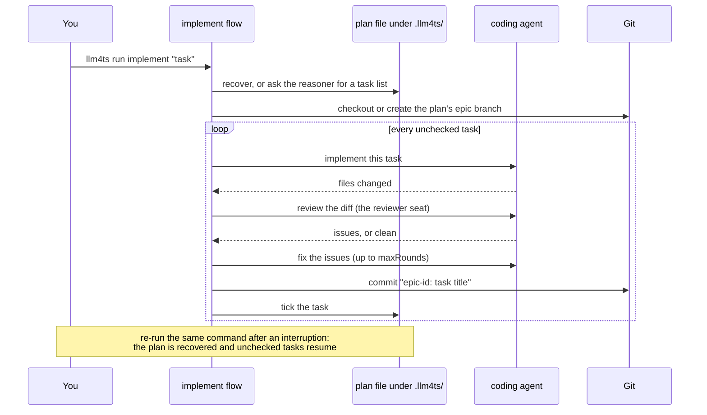
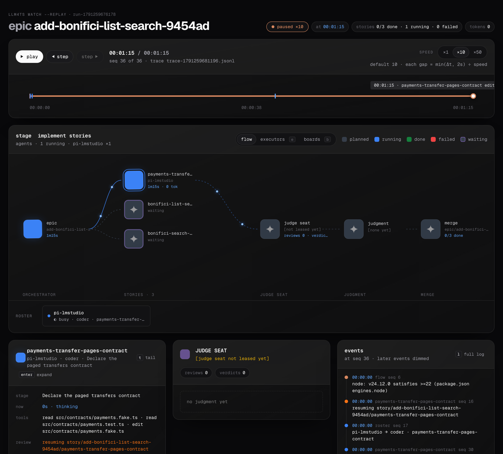
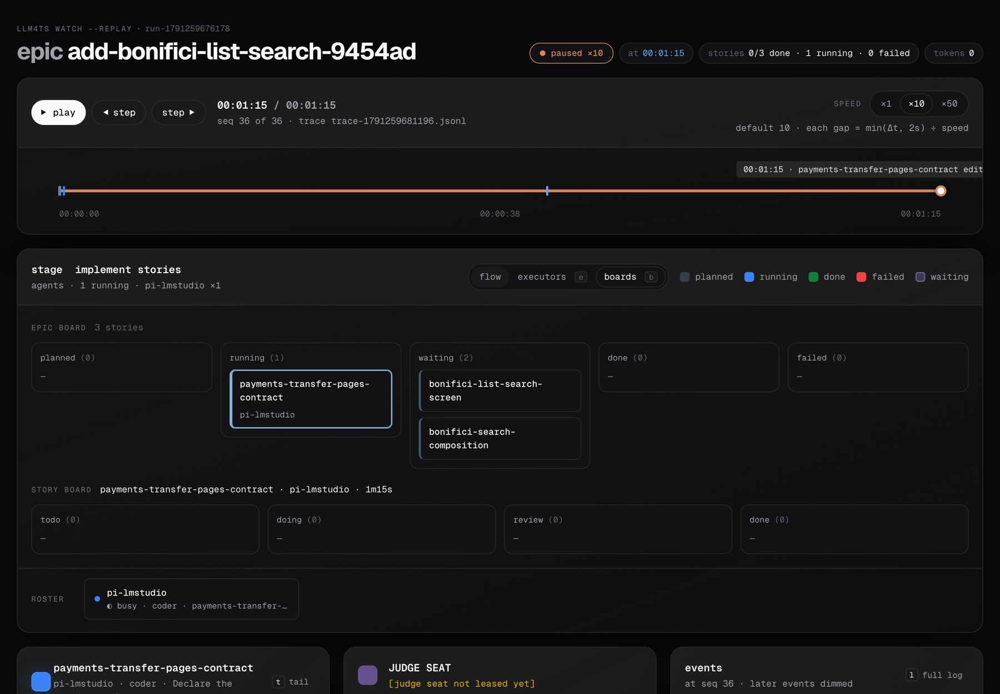

# 2. Run a flow

The built-in `implement` flow is the one to watch first: it plans a task,
then implements, reviews, and commits one task at a time, and it resumes if
you stop it. Run it on a throwaway repository so nothing you care about is
touched.

## Make a disposable repository

Any small git repository works. This one is enough:

```bash
mkdir hello-llm4ts && cd hello-llm4ts && git init -q -b main
printf 'export const add = (a, b) => a + b\n' > calc.mjs
git add -A && git commit -qm "baseline"
```

If you cloned the llm4ts repository instead, `examples/seed.sh implement`
copies a starter project, commits a baseline, and prints the exact command
to run next; `--run` starts it immediately.

## Run implement

```bash
llm4ts run implement --coder codex "Add a multiply function next to add, with a node:test test file"
```

`run` takes the flow name, then the task text. `--repo <dir>` targets another
directory (the default is the current one) and `--verbose` streams the
agent's tool calls as they happen. The terminal shows each stage start and
end, the assistant's messages, tool calls as `● run_shell_command (...)`,
and a token and cost summary at the end.

## What happened



Three files under `.llm4ts/` in the target repository carry the state:

- **`plan-<hash>.md`** is the plan, keyed by a hash of the task text. Each
  task is a `## [ ] title` heading that becomes `## [x]` when its commit
  lands. Edit it by hand between runs if the plan is wrong.
- **`trace-<timestamp>.jsonl`** records every event of the run for replay,
  including every token report with its timestamp.
- **`costs.jsonl`** gains one record per run that reported usage: when it
  started, the prompt's first line, and the tokens and cost per stage,
  agent, and model.

## Budgeting from past runs

```bash
llm4ts costs
```

reads every trace under `.llm4ts/` and prints tokens and cost per day, per
hour, per run, and per model, plus the peak day and hour. `--repo <dir>`
(repeatable) reads other repositories, `--since 2026-09-01` narrows the
window, `--tz Europe/Rome` cuts the day and hour buckets in your zone, and
`--runs-per-day 5` adds a projected daily figure for the run rate you
expect. `--json` emits the same report as data.

Measured token counts and estimates are never mixed: every seat is metered, so
a seat that reports no usage is counted from characters under the model label
`estimated:<model>` (see [configuration](../configuration.md)), and the
report keeps those in their own column. Costs come from the backend when it
reports them, otherwise from the pricing table, whose date the report
prints.

A flow's own commits never stage the trace or the ledger, but `git status`
still lists them until the repository ignores them:

```gitignore
.llm4ts/trace-*.jsonl
.llm4ts/costs.jsonl
.llm4ts/transcripts/
```

(Not the whole directory: forked packs live under `.llm4ts/kits/` and are
meant to be committed.)

Every task is its own commit on the flow's branch, so `git log` on that
branch is the story of the run and `git diff main` is the whole change.

## Watching a run: the agent tree

A run with several stories in flight (`epic-stories` on an executor roster)
is easier to follow as a tree than as a scrolling log. Add `--ui tree` to
`llm4ts run` and the terminal shows, full-screen, every running agent on one
line (its story, the executor clone that holds it, its task, time and cost),
the judge's latest verdict, a detail box for the selected story (its task
checklist, stage, last tools and figures) and a session log.

Keys: `↑`/`↓` or `1`–`9` select a story, `enter` expands its detail, `b`
opens the boards (the epic's stories and the selected story's tasks by
column), `e` shows one box per executor with its leases, `t` tails the
selection's transcript, `l` shows the whole log, `q` returns to the classic
view while the run goes on. Off a terminal, below 90 columns, or with
`NO_COLOR` set, the classic view is used.

`llm4ts watch` draws the same tree from a trace, from another terminal or
after the run: `--epic <id>` opens an epic's latest run, `watch <trace>` a
given one, bare `watch` the newest. A live trace is followed as it grows;
`--replay [--speed n]` plays a finished one back. Piped, `watch` prints one
frame and exits.

Add `--web` to draw it in a browser instead (ADR 0051). The page takes the
same keys, and the arrow keys select an executor in the executors view; a
replay also steps, scrubs, and opens at a trace line with `?seq=33`.





The page listens on `127.0.0.1` and a free port; `--port` and `--host`
choose them. `--host 0.0.0.0` shows the run to anyone who can reach the
machine, and `watch` says so when it starts. In a checkout, run `pnpm build`
first: it bundles the page.

## Where the time goes: `llm4ts profile`

When stories take long, `llm4ts profile` says where the time went:

```bash
llm4ts profile --epic <id>      # an epic's latest run
llm4ts profile <trace.jsonl>    # a given trace; bare: the newest one
llm4ts profile --epic <id> --json > run.json   # to compare runs
```

Per story, its wall time is split into **model** (the seats' calls, less
the coder's own tool time), **coder tools**, **gates** (per command, with
re-runs and failures), **merge**, **waiting** (the merge lock, a free
executor) and what is left **unaccounted**. It also lists model calls by
role and executor (with time to first output, and the API and tool time the
Gemini CLI reports), the coder's turns and how much their prompts grew, and
the time each story queued before starting, the steps per coder turn and the
model's time per step, and the coder's tool time by kind of work (explore,
edit, test, build, install, git). It opens with the three biggest
sinks in plain words, for example ``gate `pnpm test`: 14 runs, 22m10s (31%
of story time), 3 failed``.

The report holds no prompts, replies, arguments or output: only story ids,
roles, executors, tool names, gate commands as configured, counts and
durations, so it can be shared from a customer's server. A trace written
before 2.22 has no timings; its report is estimated from the gaps between
events and says so.

During a run, the agent tree shows each story's current activity and how
long it has run, and marks a story **quiet** or **idle** after
`LLM4TS_IDLE_AFTER` (default `2m`) without an event.

## Tailing what a seat says: `--transcript`

To see what a story's coder, reviewer or judge is told and answers, start the
run with a transcript:

```bash
llm4ts run epic-stories --transcript --ui tree …
```

Every seat call is then recorded under `.llm4ts/transcripts/<run-id>/`, one
file per story: the input (a chat's system prompt and messages on its first
call, then only what is new), the reply as it streams, each tool call with its
result. Secrets are redacted, long parts capped, and the files are readable
only by their owner. The trace and `llm4ts profile` stay content-free: a
transcript is never part of them. Landing the epic deletes its earlier runs'
transcripts.

In the tree, `t` shows the selection's transcript and `r` cycles the role
(all, coder, reviewer, judge). From another terminal,

```bash
llm4ts watch --epic <id> --tail <story-or-executor>
```

prints it as it grows, like `tail -f`, until the run ends.

## Exit codes and resuming

| Code | Meaning                                                      |
| ---- | ------------------------------------------------------------ |
| 0    | Every task completed and was committed                       |
| 1    | A stage failed (a review that never came clean, a gate, ...) |
| 2    | Usage error: unknown flow, unknown coder, missing argument   |

After a 1, read the last stage's message, fix what it names, and run the
same command again. Completed tasks are not redone.

## The other built-ins

| Flow           | Add to what you just saw                                      | Needs                  |
| -------------- | ------------------------------------------------------------- | ---------------------- |
| `sdd`          | A written spec, red tests first, then implementation to green | a coding agent + Maven |
| `issue-pr`     | Reads a GitHub issue, ends with a pushed pull request         | GitHub remote and `gh` |
| `epic-stories` | Splits an epic into stories run test-first by parallel coders | a reasoner CLI + pi    |
| `local`        | LM Studio reasons, a local pi agent implements                | LM Studio + pi         |
| `modernize-*`  | The six-phase legacy modernization pipeline                   | a pack, see chapter 5  |

`llm4ts view <flow>` prints any of them; [flows/README.md](../../flows/README.md)
describes each in full.

Next: [3. Your first flow](03-your-first-flow.md).
